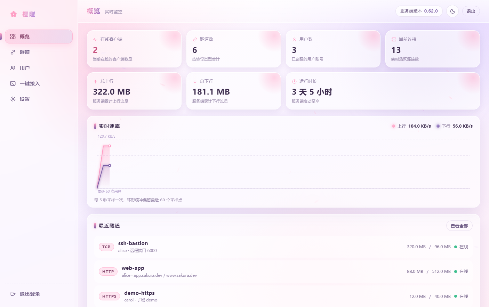
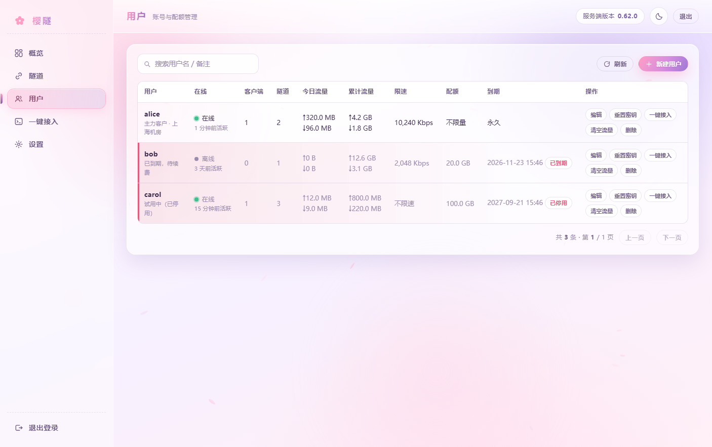
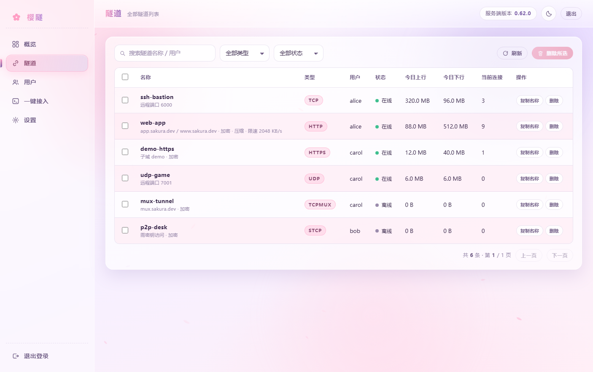
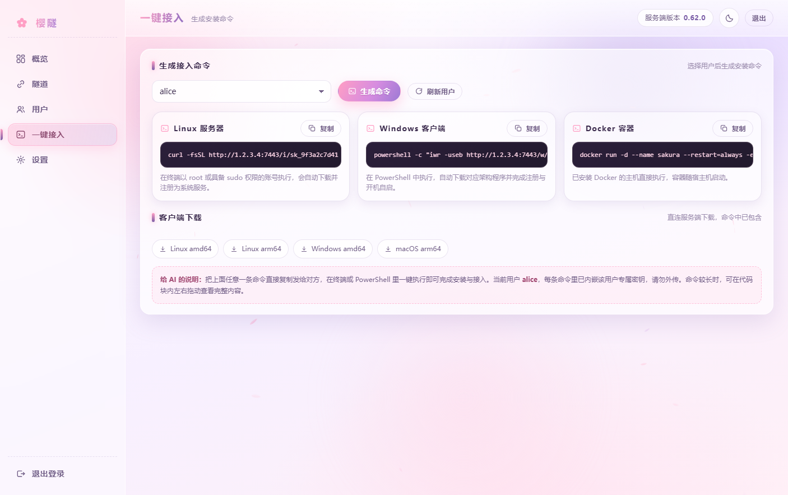

# 🌸 樱隧 Sakura Tunnel

> 基于 [frp](https://github.com/fatedier/frp) 二次开发的**多用户内网穿透服务端**。
> 一个二进制同时跑服务端和客户端，5.9 MB 起飞；自带全中文樱花风控制台、按用户限速/流量/配额、给小白的一键接入。

<p align="center">
  
</p>

---

## ✨ 特性

| | 上游 frp | 樱隧 |
|---|---|---|
| 认证 | 全局一个 token | **多租户：每户独立 token + 到期时间** |
| 面板 | 英文 Vue，要 npm 构建 | **纯静态中文樱花风，124 KB，零构建步骤** |
| 限速 | 每 proxy，客户端自己声明 | **服务端按用户强制限速（客户端改不了）** |
| 流量 | 每 proxy 今日流量 | **按用户累计 + 今日流量 + 配额** |
| 配额 | 无 | **超额拒绝登录 / 拒绝新建隧道** |
| 隧道数 | 全局 `maxPortsPerClient` | **按用户 `maxProxies`** |
| 下发 | 手写配置 | **`curl \| bash` 一键接入，自动装 systemd / 计划任务** |
| 部署 | frps + frpc 两个包 | **一个二进制双角色** |

## 📦 体积

同一份代码、`CGO_ENABLED=0 -trimpath -ldflags "-s -w"`：

| 产物 | 未压缩 | UPX `--best --lzma` |
|---|---|---|
| 上游 frp 服务端 + 客户端 | 37.0 MB | — |
| **樱隧 · linux/amd64** | 20.77 MB | **5.87 MB** |
| **樱隧 · linux/arm64** | 18.50 MB | **4.75 MB** |
| **樱隧 · windows/amd64** | 20.75 MB | **5.81 MB** |

> 一个 5.87 MB 的文件同时是服务端和客户端：`sakura` = 服务端，`sakura client` = 客户端。

## 🚀 一键安装（服务端）

```bash
# 把 scaryburial 换成你的账号（或你自己的 fork / 镜像地址）
curl -fsSL https://raw.githubusercontent.com/scaryburial/sakura-tunnel/main/install.sh | sudo bash
```

脚本会：下载对应架构二进制 → 装到 `/opt/sakura` → 生成随机面板密码 → 装 systemd → 启动 → 打印面板地址和初始口令。

自定义：

```bash
curl -fsSL .../install.sh | sudo bash -s -- \
  --bind-port 7443 --web-port 7500 --admin-user admin --admin-pass '你的密码'
```

Windows 服务端：

```powershell
iwr -useb https://raw.githubusercontent.com/scaryburial/sakura-tunnel/main/install.ps1 -OutFile install.ps1
powershell -ExecutionPolicy Bypass -File .\install.ps1 -BindPort 7443 -WebPort 7500
```

Docker：

```bash
git clone https://github.com/scaryburial/sakura-tunnel.git && cd sakura-tunnel
docker compose -f docker/docker-compose.yml up -d
```

## 🖥️ 面板

登录后五个页面，全中文，深色/浅色可切：

| 概览 | 用户（多租户） |
|---|---|
|  |  |

| 隧道 | 一键接入 |
|---|---|
|  |  |

## 👥 多用户

服务端配置：

```toml
auth.method = "user"
auth.userFile = "./users.json"
```

客户端配置：

```toml
user = "alice"

[auth]
method = "user"
token = "sk_xxxx"
```

- 每户 `users.json` 里存限额、配额、到期、备注、累计流量，原子落盘（`.tmp` → rename）；
- 登录时校验配额/到期，每次 `NewProxy` 再校验隧道数；
- 限速注入 `BaseProxy.limiter`，与 proxy 自报限额取更小值，**客户端无法绕过**；
- 流量通过 `mem.UserTrafficHook` 记账，30 秒刷一次盘。

REST API（面板就是调这些，Basic 认证）：

```
GET    /api/v2/system/info
GET    /api/v2/users?q=
POST   /api/v2/users                       -> {user, token}
PUT    /api/v2/users/{user}
DELETE /api/v2/users/{user}
POST   /api/v2/users/{user}/token          -> {token}
POST   /api/v2/users/{user}/traffic        清空累计流量
GET    /api/v2/users/{user}/install        -> {linux, windows, docker}
GET    /api/v2/proxies
DELETE /api/v2/proxies
```

响应统一信封 `{"code":200,"msg":"success","data":...}`，出错 HTTP 状态码同 `code`。

## 🔗 一键接入

面板点「一键接入」给三条命令：

```bash
# Linux / macOS
curl -fsSL http://你的域名:7500/i/sk_xxxx | bash

# Windows
powershell -NoProfile -ExecutionPolicy Bypass -Command "iwr -useb http://你的域名:7500/w/sk_xxxx | iex"

# Docker
docker run -d --network host -e SERVER=... -e PORT=... -e USER=... -e TOKEN=... sakura/client
```

脚本自动：识别架构 → 从 `/dl/sakura-linux-<arch>` 下载 → 生成 `client.toml` → root 装 systemd（普通用户 `nohup`）→ 打印转发规则。

可选参数：`... | bash -s -- --remote-port 6001 --local 127.0.0.1:8080 --dir /opt/sakura-client`

> 服务端从运行目录的 `clients/` 提供下载，把三平台二进制丢进去即可；请求的正好是本机平台时会把自身下发。

## 🛠️ 构建

```bash
# 需要 Go 1.26+
pwsh -File build/build.ps1                # Windows：linux amd64/arm64 + windows amd64，自动 UPX
bash build/build-release.sh               # Linux/macOS 同款
bash build/build-release.sh --no-upx      # 不压缩
```

产物：`dist/` 与 `dist/clients/`。

## 📁 目录结构

```
cmd/sakura/            双角色入口（sakura / sakura client）
pkg/userdb/            用户库：CRUD、token、配额、流量记账、原子落盘
pkg/auth/userauth.go   多用户校验器（登录 / 心跳 / 工作连接）
pkg/onetap/            bash / PowerShell / docker 一键脚本生成
pkg/brand/             产品名（改版只改这里）
pkg/webui/             内嵌中文控制台（dist/ 三个静态文件，无构建）
server/http/           面板 API（含 controller_users.go）
server/public_router.go /i /w /dl 公开端点
server/control.go      配额/到期/隧道数校验、用户限速取值
server/proxy/          用户限速注入
install.sh install.ps1 服务端一键安装
docker/                Dockerfile + compose
examples/              服务端/客户端配置样例、systemd 单元
docs/                  文档
```

## ⚠️ 已知限制

- 面板是**管理员级**（能看到所有租户），没有「用户登录只看自己隧道」的 RBAC；
- linux 二进制为交叉编译产物，仓库未附 CI（见下文），发布前请在目标机器跑一次 `sakura version`；
- 强制走 TLS 时控制通道不再叠加 token 加密层（每户 token 不同，无法共享传输密钥），机密性由 `transport.tls` 保证；
- UPX 版偶发被 Windows Defender 误报，介意就用未压缩版。

## 🔁 关于 CI

本仓库**故意不含 `.github/workflows/`**：作者的 PAT 缺 `workflow` 权限，推工作流会被 GitHub 拒掉并污染历史。
需要自动发布时，在网页上手动新建下面两个文件即可（内容见 `docs/发布与CI.md`）。

## 🙏 致谢与许可

基于 [fatedier/frp](https://github.com/fatedier/frp)（Apache-2.0）二次开发，保留原始版权声明，详见 [NOTICE](NOTICE)。
本项目同样以 **Apache-2.0** 发布，见 [LICENSE](LICENSE)。
